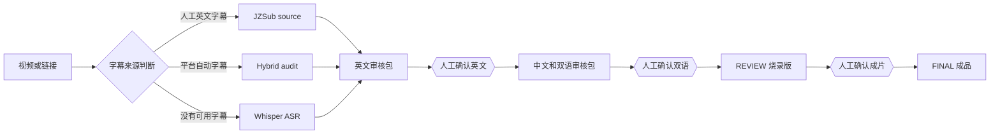

# VBS — Video Bilingual Subtitles

一个带人工审核门禁的 Codex Skill，用于把本地视频或视频链接处理为经过确认的英文字幕、简体中文字幕、中英双语字幕和烧录成片。

VBS 的重点不是“一键生成后直接发布”，而是把最容易出错的英文听写和技术翻译放在烧录之前逐步确认，避免漏词、错误数字、术语误译被永久写入视频。

> Maintained by [yzyboeing](https://github.com/yzyboeing) with Codex-assisted development.

## 工作流程



每个双线框都是强制停点。即使最初要求“全部完成”，VBS 也不会跳过尚未看到的字幕审核。

## 输入路由

| 路线 | 使用条件 | 处理方式 |
|---|---|---|
| `jzsub-source` | 有匹配视频的人工英文字幕 | 保留原始字幕，生成独立审核稿 |
| `hybrid-audit` | 只有平台自动英文字幕 | 原字幕保留，并用 Whisper 交叉检查 |
| `whisper-asr` | 没有可用字幕，或要求重新听写 | 至少两次独立识别并比较漏词与差异 |

## 主要特性

- 同时接受本地视频和授权的视频链接。
- 先判断 JZSub、Whisper 或混合审计路线。
- 对 Whisper 两次识别结果做词级差异比较，重点检查漏词、否定词、数字、单位、缩写和专有名词。
- 英文字幕、双语字幕和 REVIEW 成片分别设置人工确认门禁。
- 使用 SHA-256 锁定批准件；上游批准字幕变化时，下游产物自动失效。
- 检查 SRT 编号、时间轴、重叠、双语结构、阅读速度和视频时长边界。
- 烧录后检查视频时长、分辨率、帧率、音轨、完整解码和代表性画面。
- 正式交付前先生成带 `[REVIEW]` 标记的检查版。

## 安装

### 一键安装

需要 Node.js 18+：

```bash
npx skills add yzyboeing/vbs --skill vbs -g -a codex -y
```

### 手动安装

```bash
git clone https://github.com/yzyboeing/vbs.git
mkdir -p ~/.codex/skills
cp -R vbs/skills/vbs ~/.codex/skills/
```

安装后在 Codex 中调用：

```text
$vbs https://视频链接
```

或：

```text
$vbs /本地视频路径
```

## 运行依赖

- Python 3.10+
- FFmpeg 与 ffprobe
- [JZSub](https://github.com/pengchujin/jzsub)：用于视频链接、最高质量视频和已有字幕的获取
- 任一可用的 Whisper 实现：用于没有可用字幕的视频；Apple Silicon 可优先使用 MLX Whisper
- 带 libass 的 FFmpeg 与合适的中英文字体：推荐用于最终字幕渲染

VBS 不保存或输出浏览器 Cookie、Token、密码等凭据，也不会绕过 DRM、付费墙、验证码或平台安全限制。

## 交付阶段

### 1. 英文审核包

- `english-review.srt`
- `english-transcript.txt`
- `english-review-notes.tsv`
- 有源字幕时附 `english-source-original.*`

确认后锁定为 `english-approved.srt`。

### 2. 双语审核包

- `chinese-review.srt`
- `bilingual-review.srt`
- `bilingual-transcript.txt`
- `translation-review-notes.tsv`

确认后锁定为 `chinese-approved.srt` 和 `bilingual-approved.srt`。

### 3. 视频

- `<title> [REVIEW] bilingual.mp4`
- `burn-qa-report.json`
- 最终批准后：`<title> bilingual FINAL.mp4`

## 辅助工具

```bash
# 验证英文或双语 SRT
python3 skills/vbs/scripts/validate_srt.py subtitles.srt --mode bilingual --video input.mp4

# 比较两次 ASR，定位可能的漏词和不同结果
python3 skills/vbs/scripts/compare_asr.py pass-a.srt pass-b.srt \
  --json-report asr-differences.json > english-review-notes.tsv

# 查看工作流阶段和批准文件状态
python3 skills/vbs/scripts/checkpoint.py status job
python3 skills/vbs/scripts/checkpoint.py verify job
```

## 测试

```bash
python3 -m unittest discover -s tests -v
python3 ~/.codex/skills/.system/skill-creator/scripts/quick_validate.py skills/vbs
```

## 适用边界

“任何视频”指有权处理、可正常访问和解码的视频。如果音轨并非英语或语言不明确，VBS 会先确认目标，而不会把非英语识别结果误称为英文听写。

字幕只反映音视频内容。除非另行使用权威来源核实，VBS 不会把视频中的技术观点描述为已经验证的事实。

## 致谢

特别感谢 [JZSub](https://github.com/pengchujin/jzsub) 及其作者 [pengchujin](https://github.com/pengchujin)。JZSub 提供了高质量视频获取、源字幕选择、双语字幕和烧录流程的重要基础与启发。

VBS 是独立项目，不隶属于 JZSub，也不代表 JZSub 官方。详细说明见 [ACKNOWLEDGEMENTS.md](ACKNOWLEDGEMENTS.md)。

## 许可证

[MIT](LICENSE)

## 依赖自检与跨 AI 使用

```bash
python3 skills/vbs/scripts/check_dependencies.py
python3 skills/vbs/scripts/check_dependencies.py --require fetch --require burn
```

只检查本次需要的阶段。缺少 Whisper 不会阻断已有字幕的文本检查；链接获取仍需上游 JZSub，详见 [依赖说明](skills/vbs/references/dependencies.md)。保留本机已维护的 JZSub，删除个人同名 GitHub 仓库不代表删除运行依赖。

支持 Skill 的环境安装 `skills/vbs`；其他有文件能力的代理读取该目录的 `SKILL.md` 和引用文件。只有聊天能力时可讨论或审核字幕，无法替代脚本、转写、烧录与目视检查。安装版本以 Git 提交号记录，真实测试通过不代表每种视频和平台都能处理。
